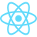
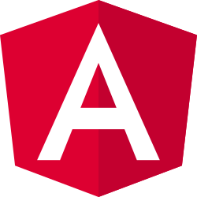
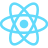
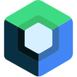
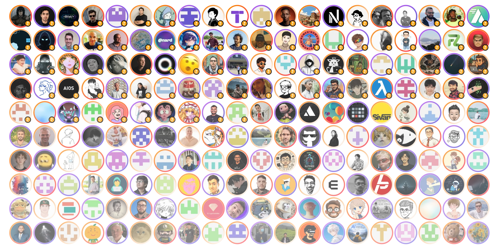

### Open-Source Icon Library for Designers & Developers

**2,700+ UI SVG icons** · free & open-source for every framework you build with.

 

  
  
  
  
  
  

 

 

## Packages

| Logo | Package | Version | Downloads | Links |
| ---- | ------- | ------- | --------- | ----- |
|  | **`reicon`** |  |  | [Docs](https://reicon.dev/docs/vanilla) · [Source](./packages/reicon) |
|  | **`reicon-react`** |  |  | [Docs](https://reicon.dev/docs/react) · [Source](./packages/reicon-react) |
|  | **`reicon-angular`** |  |  | [Docs](https://reicon.dev/docs/angular) · [Source](./packages/reicon-angular) |
|  | **`reicon-react-native`** |  |  | [Docs](https://reicon.dev/docs/react-native) · [Source](./packages/reicon-react-native) |
|  | **`reicon-vue`** |  |  | [Docs](https://reicon.dev/docs/vue) · [Source](./packages/reicon-vue) |
|  | **`reicon-svelte`** |  |  | [Docs](https://reicon.dev/docs/svelte) · [Source](./packages/reicon-svelte) |
| <picture><source media="(prefers-color-scheme: dark)" srcset="apps/web/public/framework-logos/astro.svg" /></picture> | **`reicon-astro`** |  |  | [Docs](https://reicon.dev/docs/astro) · [Source](./packages/reicon-astro) |
|  | **`reicon-flutter`** |  |  | [Docs](https://reicon.dev/docs/flutter) · [Source](./packages/reicon-flutter) |
|  | **`reicon-compose`** |  |  | [Docs](https://reicon.dev/docs/compose) · [Source](./packages/reicon-compose) |
|  | **`reicon-mcp`** |  |  | [Docs](https://reicon.dev/docs/mcp) · [Source](./packages/reicon-mcp) |
|  | **`reicon-figma`** |  |  | [Docs](https://reicon.dev/docs/figma) · [Source](./packages/reicon-figma) |
|  | **`reicon-vscode`** |  |  | [Docs](https://reicon.dev/docs/vscode) · [Source](./packages/reicon-vscode) |

## Contributing

For more info on how to contribute please see the [contribution guidelines](CONTRIBUTING.md).

## License

Reicon is totally free for commercial use and personal use, this software is licensed under the [MIT License](LICENSE).

## Credits

Thank you to all the people who contributed and supported Reicon!

Reicon base icons are built using elements from:
* [Solar Icons](https://solar-icons.vercel.app/) designed by **480 Design** (CC BY 4.0)
* [Zappicon](https://zappicon.com/)

